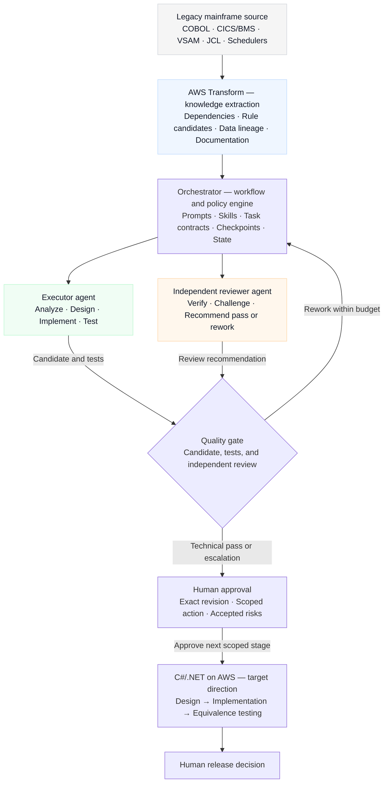

# Mainframe Modernization Agentic Framework

An evidence-driven reference framework for modernizing mainframe applications to C#/.NET, with independent review and human-controlled delivery gates.

**Status: framework foundation — documentation, contracts, and templates.** This repository does not yet contain an executable orchestrator, AWS Transform adapter, generated .NET application, or an equivalence test harness. It makes no production-readiness or migration-success claim.

## Why this framework exists

Generated documentation is useful input, but it does not prove business behavior. A credible modernization must connect source evidence to validated requirements, implementation, and measured equivalence. This framework defines that chain and the decisions people must retain.

## Evidence and capability status

| Capability | Evidence status | Public repository status |
| --- | --- | --- |
| CardDemo assessment and draft test planning with AWS Transform | Reported in a prior private workflow; not independently reproduced here | Sanitized lessons only; no raw outputs |
| Business-rule validation against pinned source | Required next step; not demonstrated here | Method and review contract |
| Executor/reviewer/orchestrator collaboration | Proposed automation | Role contracts and workflow diagrams |
| .NET generation, data conversion, and equivalence | Not demonstrated | Delivery and acceptance methodology |
| Deployment, rollback, and autonomous operation | Not demonstrated | Human approval boundaries only |

A service reporting a completed assessment step does not establish correct requirements. A generated test plan is not an executed test suite. See [limitations](docs/limitations.md).

## Multi-agent architecture — proposed



Arrows describe intended responsibilities, not implemented integrations. The executor hands its candidate to the reviewer; the reviewer checks it against independently accessed pinned source and private evidence. Both the candidate and the review are required at the quality gate. A reviewer recommends technical acceptance; a human authorizes the next action. Missing evidence blocks advancement until resolved. The [detailed workflow](architecture/multi-agent-workflow.md) shows the execution/review sequence, rework, escalation, and approval invalidation.

C#/.NET and AWS are the intended direction. Blazor, storage, hosting, and migration strategy remain architecture decisions. Skills and prompts are planned components; no executable skill library or orchestration engine is bundled.

## Start here

1. Read the [methodology](methodology/modernization.md) and [quality gates](quality-gates/README.md).
2. Define a bounded task using the [task contract](contracts/task-contract.yaml).
3. Assign the [orchestrator](agents/orchestrator.md), [executor](agents/executor.md), and [reviewer](agents/independent-reviewer.md) responsibilities. A person can perform each role today; automated coordination is future work.
4. Walk through the [synthetic CardDemo skeleton](examples/carddemo/README.md). Pin upstream source before making source-specific claims.
5. Record evidence, unresolved gaps, review results, and human decisions. Missing evidence blocks the relevant gate.

## Repository map

The current foundation contains the following files. The directory tree is documentation structure, not evidence that the proposed automation is implemented.

```text
mainframe-modernization-agentic-framework/
├── README.md
├── LICENSE
├── CONTRIBUTING.md
├── SECURITY.md
├── THIRD_PARTY.md
├── .gitignore
├── .github/
│   └── pull_request_template.md
├── architecture/
│   └── multi-agent-workflow.md
├── methodology/
│   └── modernization.md
├── agents/
│   ├── orchestrator.md
│   ├── executor.md
│   └── independent-reviewer.md
├── contracts/
│   ├── README.md
│   ├── task-contract.yaml
│   ├── review-record.yaml
│   └── approval-record.yaml
├── quality-gates/
│   └── README.md
├── examples/
│   └── carddemo/
│       ├── README.md
│       └── synthetic-example.md
└── docs/
    └── limitations.md
```

Planned additions, to be introduced in separate reviewed changes:

```text
methodology/
├── 01-discovery.md
├── 02-requirements-validation.md
├── 03-target-architecture.md
├── 04-ui-and-data-design.md
├── 05-implementation.md
└── 06-equivalence-testing.md
skills/
prompts/
docs/
└── lessons-learned.md
```

The six methodology stages are currently covered in `methodology/modernization.md`. The planned files above do not exist yet. Skills, prompts, and lessons learned will be added with bounded instructions and reviewed evidence rather than empty placeholders.

| Path | Purpose |
| --- | --- |
| [architecture](architecture/multi-agent-workflow.md) | Intended workflow, trust boundaries, and recovery |
| [methodology](methodology/modernization.md) | Discovery through cutover and rollback |
| [agents](agents/orchestrator.md) | Bounded role instructions |
| [contracts](contracts/README.md) | Task, review, and approval record templates |
| [quality-gates](quality-gates/README.md) | Evidence required to advance |
| [examples/carddemo](examples/carddemo/README.md) | Sanitized case-study skeleton and synthetic example |
| [CONTRIBUTING.md](CONTRIBUTING.md) | Attribution, validation, and PR process |
| [SECURITY.md](SECURITY.md) | Publication boundaries and vulnerability reporting |

## Delivery roadmap

- Foundation: document the method, roles, gates, and public boundaries (this change).
- Validation pilot: pin public source and validate one rule with independently reviewed evidence.
- Automation pilot: implement and test one task adapter, durable state, bounded retries, and approval enforcement.
- Implementation pilot: build one vertical .NET slice with measured equivalence and failure-path tests.
- Operational pilot: rehearse migration, recovery, observability, and rollback before any release claim.

Each milestone requires its own reviewed evidence; the roadmap is not a list of working features.

## Responsible publication and attribution

Publish original framework material and approved synthetic examples only. Never add employer or client inventories, credentials, cloud resource identifiers, private assessment exports, or raw AWS Transform artifacts. Redacting a few names from an internal export is insufficient.

This foundation was prepared with AI assistance using Codex. AI assistance does not imply independent validation. The repository owner reviews and decides what to merge; commit identity must match the owner's verified personal GitHub identity, without agent co-author attribution or concealment of assistance.

Original framework material is covered by the [MIT license](LICENSE). [AWS CardDemo](https://github.com/aws-samples/aws-mainframe-modernization-carddemo) is a separate upstream project with its own license; no application source or datasets are bundled here. See [third-party guidance](THIRD_PARTY.md).
