# Mainframe Modernization Agentic Framework

A CLI for taking pinned mainframe source through assessment, independent validation,
business review, and an approved implementation preparation package. C#/.NET on AWS
is an intended target; target design remains an explicit architecture decision.

**Status: four-phase POC implemented and tested with offline fixtures. Live AWS and
agent-provider acceptance is pending.** No application buildout, deployment, data
migration or runtime equivalence is claimed. AI assistance is used to develop this
framework and to prepare candidate artifacts; humans retain approval authority.

**Start with the [CLI guide](docs/cli-guide.md).** Supply a GitHub URL or clean local
Git checkout, configure your own AWS/provider access, and use the built-in protocols.
No custom prompt writing or manual agent handoffs are required for normal operation.

```bash
./modernize --help
./modernize --workspace /path/to/private-poc init \
  --source /path/to/mainframe-checkout --scope "One bounded business journey"
```

## Why this framework exists

Generated documentation is useful input, but it does not prove business behavior. A credible modernization must connect source evidence to validated requirements, implementation, and measured equivalence. This framework defines that chain and the decisions people must retain.

## Evidence and capability status

| Capability | Evidence status | Public repository status |
| --- | --- | --- |
| AWS Transform assessment | Setup/job adapters tested with fixtures; live acceptance pending | GitHub/local source, chosen S3 destination, workspace/connector setup, existing local/S3 findings, wait/resume |
| Independent validation | Structural checks and synthetic handoff verified | Claude Sonnet executor plus Claude Opus reviewer independently request source and findings; distinct pinned model IDs, bounded rework |
| Approval gates | Hash invalidation tested | Separate assessment, SME/architect and business specification gates |
| HTML business review | Deterministic rendering and escaping tested | Claude/Codex-generated screen content; inert HTML with rules, states and specifications |
| Implementation preparation | Synthetic four-phase package tested | Versioned ZIP with specifications, prompts, backlog, decisions, monorepo proposal and checksums |
| Repeated assessment comparison | Fixture comparison tested; live CardDemo runs pending | Preserved snapshots, normalized content diff and optional source-grounded AI comparison |
| Application buildout, migration and equivalence | Not implemented by this POC | Future engineering work guided by the preparation package |

A service reporting a completed assessment step does not establish correct requirements. A generated test plan is not an executed test suite. See [limitations](docs/limitations.md).

## POC workflow

```mermaid
flowchart LR
    S[GitHub or local source] --> A[AWS Transform or existing findings]
    A --> G1[Human assessment approval]
    G1 --> E[Executor prepares specifications]
    E --> R[Claude Code independent review]
    R -->|Bounded corrections| E
    R --> G2[SME decisions and validation approval]
    G2 --> UI[Claude or Codex wireframe content]
    UI --> H[HTML stakeholder review]
    H --> G3[Business approval of exact version]
    G3 --> P[Implementation package]
    P -. Future engineering .-> M[Monorepo and actual buildout]
```



Each phase stops at its approval boundary. Service completion and reviewer PASS do
not approve business requirements. Private records preserve provenance, uncertainty,
review results and exact approved versions. Deferred decisions retain explicit
blocked downstream work. Microservices are evaluated against alternatives, not assumed.

The [CLI guide](docs/cli-guide.md) describes implemented behavior and limitations.
The [broader reference architecture](docs/images/reference-architecture.svg) and
[detailed delivery workflow](architecture/multi-agent-workflow.md) include future
implementation/equivalence stages beyond this preparation POC.

## Start here

The four-phase CLI is the primary POC interface. The six methodology guides below cover the broader modernization lifecycle, including future buildout and equivalence work.

| Phase | Guide |
| --- | --- |
| 1 | [Scope and discovery](methodology/01-discovery.md) |
| 2 | [Requirements validation](methodology/02-requirements-validation.md) |
| 3 | [Target architecture](methodology/03-target-architecture.md) |
| 4 | [UI and data design](methodology/04-ui-and-data-design.md) |
| 5 | [Incremental implementation](methodology/05-implementation.md) |
| 6 | [Equivalence testing and release readiness](methodology/06-equivalence-testing.md) |

**Primary path:** [four-phase CLI setup and execution](docs/cli-guide.md).
**Experiment:** [two-run CardDemo comparison](docs/assessment-comparison.md).
**Legacy diagnostics:** [single-rule Kiro adapter](docs/kiro-automation.md) and
[manual pilot runner](docs/running-a-pilot.md). These are retained for compatibility;
they are not the new four-phase interface.

1. Read the [methodology](methodology/modernization.md) and [quality gates](quality-gates/README.md).
2. Define a bounded task using the [task contract](contracts/task-contract.yaml).
3. Assign the [orchestrator](agents/orchestrator.md), [executor](agents/executor.md), and [reviewer](agents/independent-reviewer.md) responsibilities. The CLI dispatches roles; the manual instructions remain diagnostic references.
4. Walk through the [synthetic CardDemo skeleton](examples/carddemo/README.md). Pin upstream source before making source-specific claims.
5. Record evidence, unresolved gaps, review results, and human decisions. Missing evidence blocks the relevant gate.

## Repository map

The current foundation contains the following files. The tree includes documentation and the initial controllers; code presence does not establish live-service acceptance.

```text
mainframe-modernization-agentic-framework/
├── README.md
├── modernize                         # Four-phase CLI entry point
├── LICENSE
├── CONTRIBUTING.md
├── SECURITY.md
├── THIRD_PARTY.md
├── .gitignore
├── .github/
│   └── pull_request_template.md
├── architecture/
│   └── multi-agent-workflow.md
├── methodology/
│   ├── modernization.md
│   ├── 01-discovery.md
│   ├── 02-requirements-validation.md
│   ├── 03-target-architecture.md
│   ├── 04-ui-and-data-design.md
│   ├── 05-implementation.md
│   └── 06-equivalence-testing.md
├── prompts/
│   ├── README.md
│   ├── 01-executor.md
│   ├── 02-independent-reviewer.md
│   ├── 03-orchestrator.md
│   ├── 04-rule-validation-pilot.md
│   ├── automated/                   # Legacy single-rule protocols
│   │   ├── executor.md
│   │   └── reviewer.md
│   └── pipeline/
│       ├── executor.md
│       ├── reviewer.md
│       ├── wireframes.md
│       └── comparison.md
├── agents/
│   ├── orchestrator.md
│   ├── executor.md
│   └── independent-reviewer.md
├── contracts/
│   ├── README.md
│   ├── task-contract.yaml
│   ├── review-record.yaml
│   └── approval-record.yaml
├── quality-gates/
│   └── README.md
├── examples/
│   ├── config/
│   │   ├── claude-settings.example.json
│   │   └── kiro-settings.example.json
│   └── carddemo/
│       ├── README.md
│       └── synthetic-example.md
├── scripts/
│   ├── pilot.py
│   ├── kiro_workflow.py
│   ├── modernize.py
│   ├── modernize_models.py
│   └── modernize_artifacts.py
├── tests/
│   ├── test_pilot.py
│   ├── test_kiro_workflow.py
│   ├── test_mcp_transport.py
│   ├── test_modernize.py
│   └── fixtures/
│       └── mcp_server.py
└── docs/
    ├── images/
    │   └── reference-architecture.svg
    ├── cli-guide.md
    ├── assessment-comparison.md
    ├── kiro-automation.md
    ├── limitations.md
    └── running-a-pilot.md
```

Installed `skills/` and `docs/lessons-learned.md` remain future additions; they are not part of the current tree. Lessons learned require actual reviewed execution evidence.

| Path | Purpose |
| --- | --- |
| [architecture](architecture/multi-agent-workflow.md) | Intended workflow, trust boundaries, and recovery |
| [methodology](methodology/modernization.md) | Discovery through cutover and rollback |
| [agents](agents/orchestrator.md) | Bounded role instructions |
| [prompts](prompts/README.md) | Stable role instructions consuming one task manifest |
| [modernize CLI](docs/cli-guide.md) | Four-phase setup, assessment, validation, HTML and packaging |
| [assessment comparison](docs/assessment-comparison.md) | Controlled two-run experiment and its limits |
| [Kiro automation](docs/kiro-automation.md) | Legacy single-rule adapter diagnostics |
| [pilot runner](docs/running-a-pilot.md) | Manual diagnostic operations and record-integrity checks |
| [contracts](contracts/README.md) | Task, review, and approval record templates |
| [quality-gates](quality-gates/README.md) | Evidence required to advance |
| [examples/carddemo](examples/carddemo/README.md) | Sanitized case-study skeleton and synthetic example |
| [CONTRIBUTING.md](CONTRIBUTING.md) | Attribution, validation, and PR process |
| [SECURITY.md](SECURITY.md) | Publication boundaries and vulnerability reporting |

## Delivery roadmap

- Foundation: method, roles, gates, diagrams, public boundaries, phase guides, and stable prompts are supplied.
- Local pilot runner: shared manifest, metered operations, sealing, and review preflight are implemented for manual diagnostics.
- Validation pilot: pin public source and validate one rule with independently reviewed evidence.
- Preparation CLI: four phases, Claude Code review, HTML, versioned packages and repeated assessment comparison implemented; live provider/AWS acceptance pending.
- Implementation pilot: build one vertical .NET slice with measured equivalence and failure-path tests.
- Operational pilot: rehearse migration, recovery, observability, and rollback before any release claim.

Each milestone requires its own reviewed evidence; the roadmap is not a list of working features.

## Responsible publication and attribution

Publish original framework material and approved synthetic examples only. Never add employer or client inventories, credentials, cloud resource identifiers, private assessment exports, or raw AWS Transform artifacts. Redacting a few names from an internal export is insufficient.

This foundation was prepared with AI assistance using Codex. AI assistance does not imply independent validation. The repository owner reviews and decides what to merge; commit identity must match the owner's verified personal GitHub identity, without agent co-author attribution or concealment of assistance.

Original framework material is covered by the [MIT license](LICENSE). [AWS CardDemo](https://github.com/aws-samples/aws-mainframe-modernization-carddemo) is a separate upstream project with its own license; no application source or datasets are bundled here. See [third-party guidance](THIRD_PARTY.md).
