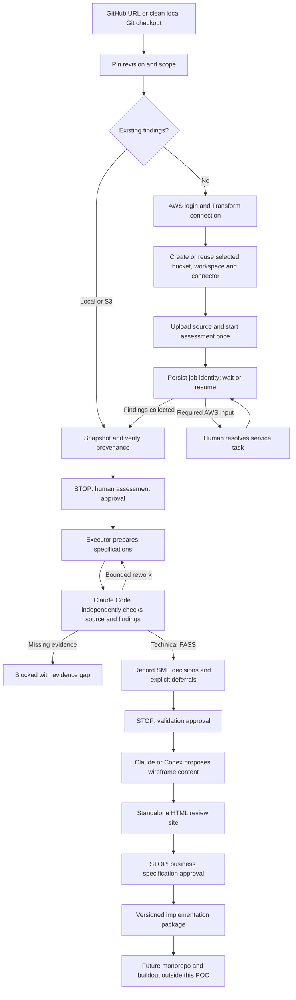

# Modernization preparation CLI

The `modernize` entry point prepares a reviewed implementation package. It does not
build a target application, deploy infrastructure for that application, migrate data,
or prove behavioral equivalence. AWS assessment resources are the only cloud
resources this CLI can create.

**Status:** implemented and covered by offline tests, including a synthetic
four-phase acceptance path. Live AWS, Kiro, Claude Code and Codex provider execution
is still pending acceptance. Do not describe fixture results as a CardDemo result.
Python 3.10+ on macOS/Linux is required; Windows is not supported by the current
file-lock/process-group implementation. Run from a clean committed framework checkout.

## Four phases



## 1. Initialize once

Authenticate Git if using a private GitHub repository. Authenticate AWS in your own
terminal, for example `aws sso login --profile <your-profile>` for a previously
configured SSO profile. The framework does not collect passwords or store AWS keys.

```bash
./modernize --workspace /path/to/private-poc init \
  --source https://github.com/aws-samples/aws-mainframe-modernization-carddemo.git \
  --ref <full-reviewed-source-commit> \
  --scope "CardDemo sign-on journey; exclude other application journeys" \
  --aws-profile <your-profile> --region <your-region> --bucket <your-private-bucket> \
  --executor kiro --ui-provider claude
```

For local source, pass its clean Git checkout path and omit `--ref`. Source is not
edited. GitHub sources are cloned to the private workspace without running repository
hooks or installing project dependencies. The clone is pinned; changing source or
framework revision requires a new workspace. Record the same source commit for both
comparison runs. Assessment uploads currently contain safe tracked repository files;
the scope narrows the requested analysis, not the archive. Inspect the upload manifest
and authorize the entire source before a new assessment. Hidden files and obvious
credential filenames are excluded; this is **not** secret detection.

The private workspace must be outside framework/source checkouts. Keep all findings,
cloud identities and generated packages private. A package may contain sensitive
business information even though it excludes raw AWS exports and credentials.

`--settings /path/to/private-settings.json` accepts the settings documented in the
[legacy adapter guide](kiro-automation.md), including model names, byte limits,
maximum invocations/rounds, MCP command and optional findings output location.
`wireframes_model` selects the UI model; reviewer/executor models are separate.
Default executor is Kiro; reviewer is always Claude Code in this POC. The executor
may also be `claude` or `codex`. Different sessions/providers do not prove independence
of reasoning or correctness. Limits bound CLI invocations, not total provider tokens
or cloud dollars. There is no hard financial cap.

## 2. Prepare AWS assessment access

Install AWS CLI and `uv` (for the official Transform MCP server). New AWS operations
need the optional MCP Python SDK. One way to invoke the CLI without changing your
system Python is:

```bash
uv run --with 'mcp>=2,<3' python scripts/modernize.py \
  --workspace /path/to/private-poc setup \
  --create-bucket --create-workspace <workspace-name> --create-connector <connector-name>
```

Omit `--create-bucket` for an existing bucket. The CLI checks ownership and public
access blocking; it does not overwrite an existing bucket's security configuration.
New buckets get public access blocking and AES256 default encryption. Bucket creation
is optional and separate from target infrastructure deployment.

Use `--transform-workspace <id>` during init or `setup --attach-workspace <id>` to reuse
a workspace. Use `setup --attach-connector <id>` to reuse a connector. These private
identifiers must never go into the framework repository.

**AWS login is not necessarily a Transform application connection.** The official
MCP `configure` operation supports its own authentication flow. If it is not already
configured, pass `setup --connect /path/to/private-configure-arguments.json`; the
controller checks that payload against the server's actual tool schema. Follow the
[official Transform MCP setup](https://github.com/awslabs/mcp/tree/main/src/aws-transform-mcp-server).
Do not put cookies/tokens in Git or shell command arguments. The framework does not
provision Identity Center or broad IAM policies, or bypass browser/administrator steps.
Use a pinned tested MCP package version in private settings for repeatable experiments.

A newly created connector must be activated. The CLI returns its verification link.
An administrator can approve there; alternatively `setup --role-arn <existing-approved-role>`
calls the supported activation operation. Confirm readiness explicitly:

```bash
./modernize --workspace /path/to/private-poc setup \
  --connector-approved "Named AWS administrator"
```

Run setup with the MCP-enabled Python environment each time it needs the MCP transport.
The confirmation is a local human attestation, not an authenticated signature or proof
of all service permissions. Actual ingestion must still be checked in the assessment.
Creation intent and receipts are persisted. Lost responses block retries; reconcile
in AWS and attach the existing workspace/connector. Do not delete state to retry.

## 3. Assess; leave and resume

```bash
uv run --with 'mcp>=2,<3' python scripts/modernize.py \
  --workspace /path/to/private-poc assess --label run-a --allow-new-assessment --detach
./modernize --workspace /path/to/private-poc status
uv run --with 'mcp>=2,<3' python scripts/modernize.py \
  --workspace /path/to/private-poc resume --label run-a --detach
```

`--wait` watches in the foreground. `--detach` starts a local process; it is not a
cloud-hosted scheduler and may pause during sleep/shutdown. AWS continues independently.
Resume the same label. A watcher exits after its saved poll limit. `status` is read-only.
`resume` never creates a missing label. A lost job-creation response requires
`resume --label run-a --attach-job <verified-job-id>`; attachment checks the recorded
run name in the returned job. Required AWS human tasks remain explicit pause states.

Existing findings bypass job creation and AWS setup:

```bash
./modernize --workspace /path/to/private-poc assess --label imported \
  --findings /path/to/existing-findings
# Or --findings s3://your-private-location/findings/
```

Supported inputs are bounded UTF-8 JSON/Markdown/text/CSV/YAML files or directories.
Archives, nested/binary service exports and unrecognized export shapes require a
supported text export location; the CLI fails visibly instead of treating status
metadata as findings. Attach an export with `resume --label run-a --findings <location>`
only before the snapshot is sealed. Imported findings/source association starts
unverified and must be checked by the human owner.

**The controller stops after collecting findings. It does not start agents.**
Inspect the private assessment, source-upload manifest, scope/ingestion coverage and
service tasks before confirming:

```bash
./modernize --workspace /path/to/private-poc approve assessment --label run-a \
  --by "Assessment owner" --note "Reviewed ingestion, scope and provenance" --confirm-source-match
```

## 4. Validate and prepare

Install/authenticate the selected provider CLIs separately. Kiro headless requires
its own configured CLI and credentials; the IDE alone is insufficient. Claude Code
reviewer uses noninteractive bare mode with built-in/MCP tools disabled. Codex uses
noninteractive read-only mode, disables known execution/search/agent integrations,
and rejects unexpected tool events. These flags must be acceptance-tested against
installed versions; they are not an OS-level isolation guarantee. No cloud authority
is delegated to model roles. Use approved provider accounts for your source data.

```bash
./modernize --workspace /path/to/private-poc validate
```

The controller supplies reusable protocols, inventories and bounded evidence reads.
Executor and reviewer each read primary source **and** findings. Candidate/review
versions, budgets and context histories persist. REWORK loops automatically within
saved limits. Authentication failure can be retried with `validate`; call counts
remain consumed. Evidence gaps or exhausted limits stop. No manual role handoff or
rewritten prompt is required. Approval names are local attestations; enterprise
identity/authorization and signed approvals are outside this POC.

Specifications cover rules, architecture, UI, service/API boundaries, data,
infrastructure, security, migration, tests, operations, delivery, reusable build
prompts and a dependency-ordered implementation backlog. Microservices are evaluated
against alternatives, not assumed. Structural checks cannot guarantee completeness.

Record each SME answer or explicit deferral:

```bash
./modernize --workspace /path/to/private-poc decide --question <question-id> \
  --by "Business SME" --answer "Decision and rationale" --disposition resolved
./modernize --workspace /path/to/private-poc approve validation \
  --by "Accountable architect" --note "Reviewed evidence, decisions and excluded scope"
```

`--disposition deferred` retains the question's blocked downstream work. Deferral
is not permission to implement that work. Decisions are overlays tied to the exact
candidate; if an answer changes a specification, use feedback and rerun validation
so the change is incorporated before approval.

## 5. Business review and revision

```bash
./modernize --workspace /path/to/private-poc review-site --provider codex
# Or --provider claude
```

Open the printed `index.html`. It contains wireframe layouts, screen states,
business rules, source references, proposed architecture and technical specifications,
SME decisions and unexecuted acceptance scenarios. It is a standalone review document:
fields/actions are disabled, all model content is escaped, no external assets or
JavaScript are loaded. It is not an interactive backend simulation.

```bash
./modernize --workspace /path/to/private-poc feedback \
  --by "Business owner" --note "Describe the required change"
./modernize --workspace /path/to/private-poc validate
```

Feedback preserves previous files, creates a new candidate round and invalidates
validation/business approvals and decisions. Reapprove the revised candidate, then
regenerate the site. Rework and explicit feedback share the saved round/call limits.
To approve an unchanged site:

```bash
./modernize --workspace /path/to/private-poc approve specifications \
  --by "Business owner" --note "Reviewed the exact HTML version and scope"
```

Approvals record artifact hashes, owner, rationale and time. Changed specifications,
findings or HTML block downstream use. They are not tamper-proof signatures against
someone deliberately rewriting the private state files.

## 6. Package for implementation

```bash
./modernize --workspace /path/to/private-poc package
```

The private ZIP contains specifications, rule/test traceability, decisions, approvals,
HTML, ten implementation prompts, dependency-ordered backlog, proposed monorepo layout,
provenance and checksums. It excludes raw AWS results, source archives, provider
receipts and workspace settings. Tests remain NOT RUN. This prepares a future
monorepo/buildout; it does not create or deploy application code.

## Compare two assessments

Before selecting a baseline for validation, run a second independently authorized
assessment with `--label run-b` using the unchanged checkout/configuration. See the
[repeatability protocol](assessment-comparison.md). Neither run overwrites the other.

```bash
./modernize --workspace /path/to/private-poc compare --left run-a --right run-b
./modernize --workspace /path/to/private-poc compare --left run-a --right run-b --semantic --provider claude
```

The first command emits a deterministic content diff and flags recorded configuration
mismatches. The second adds bounded AI-assisted comparison of both findings with
independent source reads, evidence references, coverage limitations and SME-required
verdicts. It still requires human review; two runs do not establish general reliability.
Large findings require selective reads and may exceed configured limits; the controller
stops instead of truncating or claiming full coverage.

## Verification

Run `python3 -m unittest discover -s tests -v`. Optional MCP transport tests need the
SDK. Tests use synthetic findings and provider/AWS fixtures, not live services.
For live acceptance, verify actual provider flags/behavior, AWS authentication,
resource setup, source ingestion, findings retrieval, sleep/restart recovery,
required human pauses, all approval gates, comparison and package traceability.

Official integration references:
[Kiro headless](https://kiro.dev/docs/cli/headless/),
[Claude Code CLI](https://code.claude.com/docs/en/cli-reference),
[Codex noninteractive execution](https://learn.chatgpt.com/docs/non-interactive-mode),
[AWS Transform developer tools](https://docs.aws.amazon.com/transform/latest/userguide/developer-tools.html).
